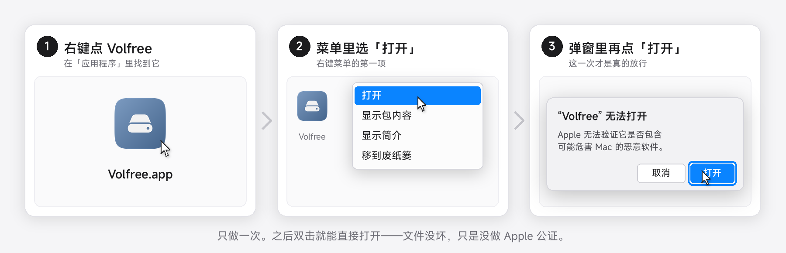
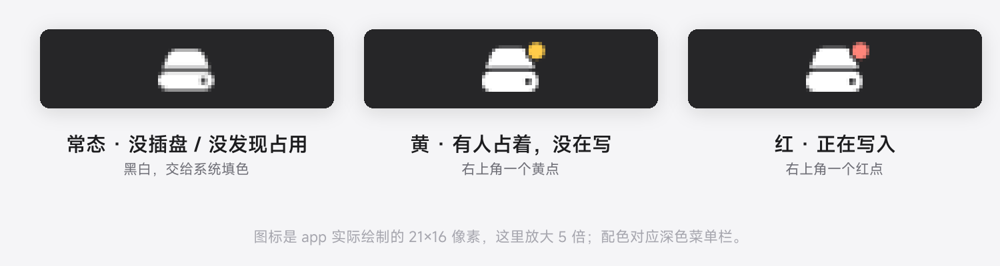
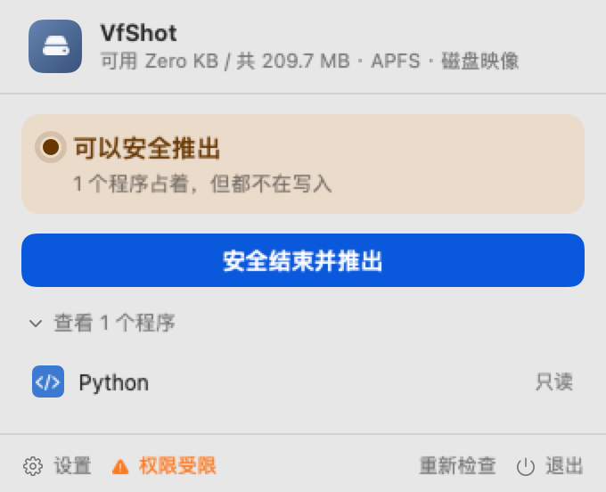
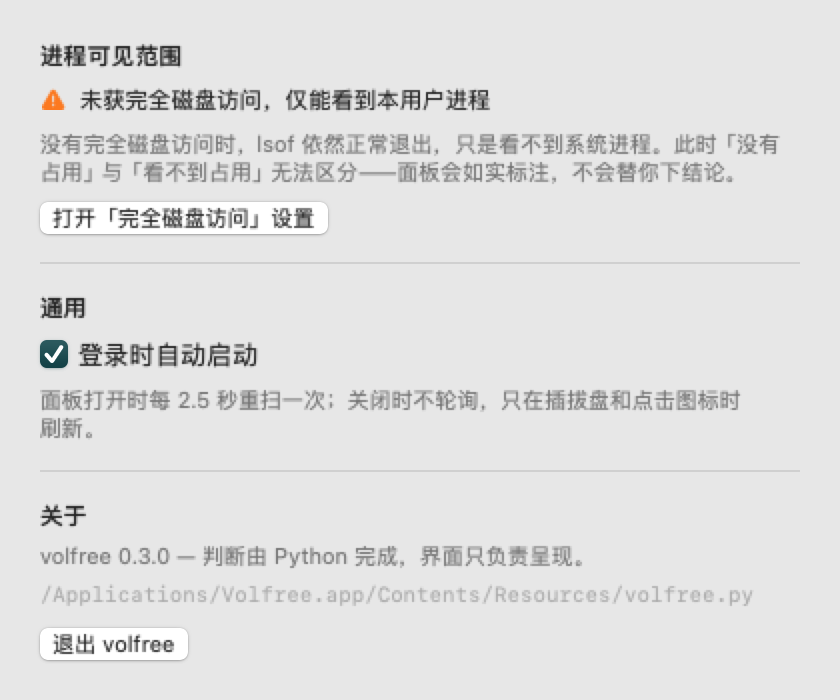

# volfree

移动硬盘「**现在能不能安全拔**」——拔了会不会丢数据。macOS 菜单栏应用 + 单文件命令行工具。

<p align="center">
  <a href="https://github.com/ooaaeiei2-beep/volfree/releases/latest/download/Volfree-0.3.1.dmg"><b>下载 Volfree-0.3.1.dmg</b></a><br>
  <sub>约 1.1 MB · macOS 14 或更新 · 打开 dmg，把 Volfree 拖进「应用程序」</sub>
</p>

没有 Apple 开发者账号（$99/年），app 只能 adhoc 签名、过不了 Gatekeeper 校验——首次打开按下面三步走一次，之后双击就正常了。



## 界面

菜单栏图标三态——没插盘 / 没发现占用、有人占着、正在写入：



点开面板，谁占着、在不在写、写得有多快，逐条列出来：



设置里是权限范围、登录项和版本号：



## 它回答的问题

| 颜色 | 含义 | 能不能拔 |
|---|---|---|
| 绿 | 没发现占用 | 可以 |
| 黄 | 有人占着，但没在写 | 先结束进程再拔 |
| 黄（放弃写入） | 写的是**已删除**的临时文件 | 结束会丢数据，且找不回来 |
| 红 | 正在写入 | 等它写完 |


权限受限时（没有「完全磁盘访问」），绿态文案会降级为「**未发现**占用」而不是「可以拔了」——
「没有占用」和「看不到占用」这时无法区分，不替你下这个结论。

不是看「有没有文件被打开」这么简单——macOS 的 `lsof` 不像 Linux 那样在已删除文件后标注
`(deleted)`，路径照常显示；而 mmap 写入**不改变文件长度**，看 size 永远是零增长。
这个工具处理的就是这些容易误判的情况。

## 安装

### 命令行版（单文件）

[volfree.py](https://github.com/ooaaeiei2-beep/volfree/releases/latest/download/volfree.py)
— 单个文件，零依赖，没有任何签名问题。

```sh
curl -LO https://github.com/ooaaeiei2-beep/volfree/releases/latest/download/volfree.py
python3 volfree.py
```

### 进阶：一行脚本

给愿意把脚本直接喂给 shell 的命令行用户。它会：取最新版本 → 下载 dmg → 装进 `/Applications`
→ **去掉隔离属性** → 启动。隔离属性那一步是必需的，不去掉的话首次打开还是会被 Gatekeeper 拦，
所以这条路能省掉首屏那三步。

```sh
curl -fsSL https://raw.githubusercontent.com/ooaaeiei2-beep/volfree/main/install.sh | sh
```

不想直接管道执行的话，可以先看一眼再跑：

```sh
curl -fsSL https://raw.githubusercontent.com/ooaaeiei2-beep/volfree/main/install.sh | less
# 或者钉住某个版本，而不是跟着 main 走：
curl -fsSL https://raw.githubusercontent.com/ooaaeiei2-beep/volfree/v0.3.1/install.sh | sh
```

### 跳过那三步：清隔离属性

已经装好、但不想每次新版本都右键一遍的话，清一次隔离属性即可（`install.sh` 做的就是这件事）：

```sh
xattr -cr /Applications/Volfree.app
```

## 命令行

```sh
python3 volfree.py              # 交互式诊断
python3 volfree.py status       # 一次报告所有卷
python3 volfree.py analyze /Volumes/X
python3 volfree.py release /Volumes/X          # dry-run，加 --apply 才真执行
```

零依赖，只用 Python 标准库。

## 菜单栏应用

```sh
cd app
./make_icon.sh      # 生成图标（需要 swiftc）
./build.sh          # 产出 build/Volfree.app
open build/Volfree.app
```

登录项要求 app 在 `/Applications` 下才能注册。

## 判定为什么是二维的

**link 状态**（有名字 / 已 unlink）× **访问模式**（只读 / 可写），四格分别定级。
退回一维（只看「有没有人打开」）会把「写已删除文件」这种情况误判成安全。

可写性必须**三态**：`yes / no / unknown`。`unknown` 不等于 `no`——
lsof 对 mmap 文件报的 `fd=txt` 条目 access 恒为空，得用
`proc_pidinfo(PROC_PIDREGIONPATHINFO)` 读 `pri_protection` 的 `VM_PROT_WRITE` 位才知道。

判定依据写在 [`docs/文件系统语义核查.md`](docs/文件系统语义核查.md)，
22 例语义基准在 [`docs/判定情况全表.md`](docs/判定情况全表.md)，
`experiments/matrix.py` 可以逐格复跑。

## 目录

| 路径 | 内容 |
|---|---|
| `volfree/` | 源码包：`scan` 扫描解析、`policy` 定级规则、`render` 输出、`cli` 命令分发等 8 个模块 |
| `volfree.py` | 单文件 CLI（约 2000 行，零依赖）——**由 `tools/bundle.py` 从 `volfree/` 生成，不要直接编辑** |
| `app/` | 菜单栏应用（SwiftUI + AppKit，SPM 构建）——**细节看 [app/README.md](app/README.md)** |
| `docs/` | 判定依据与 22 例基准表；`docs/img/` 是 README 里的示意图 |
| `design/` | 面板原型（HTML）与版式检查脚本 |
| `experiments/` | 造测试场景的脚本（mmap 写入、已删除文件、各种文件系统） |
| `tests/` | 109 项单元测试 |

## 测试

```sh
python3 -m unittest discover -s tests -p "test_*.py"
python3 experiments/matrix.py      # 22 例判定矩阵
```

改了 `volfree/` 里的模块之后，记得重新生成单文件——app 和 `curl | sh` 读的都是它：

```sh
python3 tools/bundle.py
```

## 已知限制

- 未签名分发：adhoc 签名，换机器需重新构建
- 开机自启是否真的生效没验证过（需要重启确认）
- 空闲时每 5 秒查一次占用，约合 4.9% 个核心；面板打开时每 2.5 秒全量重扫，约 13%

## 许可

[MIT](LICENSE)
